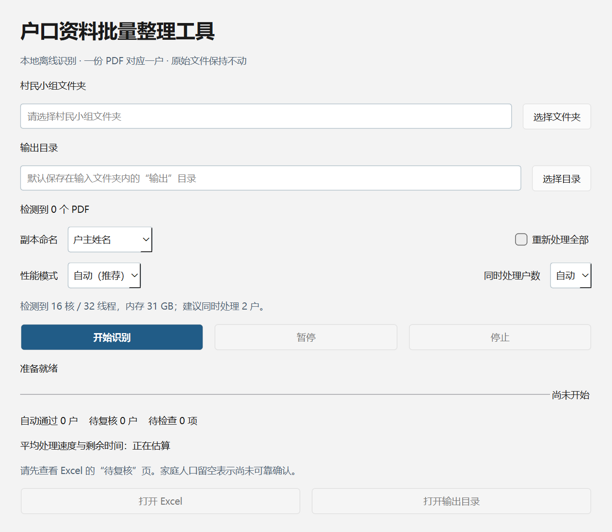

# Household Registration Document Processor

[简体中文](README.md)

An offline Windows OCR tool for scanned household registration PDFs. It treats one PDF as one household, aligns pages, extracts fields from household covers and member cards, and writes Excel sheets for member records, manual review, and processing logs. It creates separate PDF copies and preserves originals.

## Download for Windows

**[Download v1.2.0 Windows x64 ZIP](https://github.com/kyrieouhan/hukou-document-tool/releases/download/v1.2.0/HukouTool-1.2.0-Windows-x64.zip)** · [Release notes and SHA-256](https://github.com/kyrieouhan/hukou-document-tool/releases/tag/v1.2.0)

Extract the entire ZIP, open the `HukouTool` folder, and double-click `HukouTool.exe`. Keep the `_internal` folder next to the executable. The portable build includes its runtime and OCR models.



## Run from source

Install Python 3.12 and run the following in PowerShell from the repository root.

```powershell
py -3.12 -m venv .venv
.\.venv\Scripts\python.exe -m pip install -r requirements.txt
.\.venv\Scripts\python.exe scripts\fetch_models.py
.\.venv\Scripts\python.exe main.py
```

The setup step downloads public OCR weights and verifies them using SHA-256. Once configured, recognition and export run locally. Select a directory of documents you are authorized to process and review the flagged fields before using the export. The desktop UI and Excel headers are in Simplified Chinese.

## Implementation

- **Document processing:** PyMuPDF rasterizes pages, and OpenCV and NumPy handle orientation and layout.
- **Recognition:** RapidOCR with local PP-OCR weights and ONNX Runtime CPU inference. Uncertain fields go to a review sheet.
- **Batch work:** The scheduler supports configurable parallelism, pause and stop controls, and checkpoint-based resume.
- **Delivery:** PySide6 desktop UI, `parse` and `batch` CLI modes, openpyxl workbook exports, and a PyInstaller Windows build.

Run `.\.venv\Scripts\python.exe -m pytest -q` for the checks or `.\build.ps1` to build the Windows application. See the [Chinese README](README.md) for CLI examples and [third-party notices](docs/third-party.md) for model attribution. Recognition depends on document layout and scan quality and requires human review.

## License

The application source is licensed under [AGPL-3.0](LICENSE). See [portable release notices and corresponding source](docs/windows-release-notices.md).
