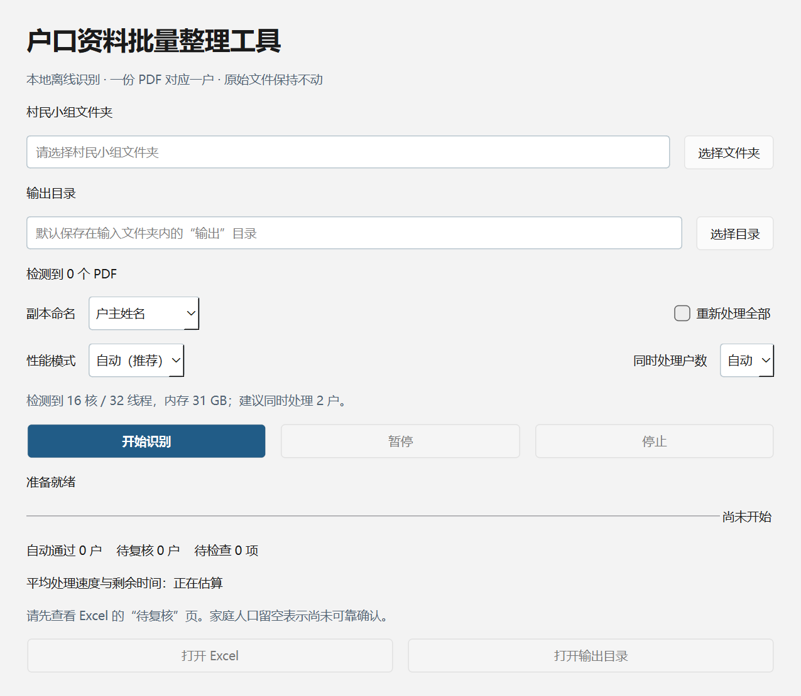

# 户口资料批量整理工具

**Windows 本地 OCR 与 Excel 导出** · [English](README.en.md)

按目录读取扫描 PDF，一份 PDF 对应一户。程序在本机校正页面方向、定位户口簿版面、识别字段，并生成 Excel 汇总和复核清单。原始 PDF 保持不变。

## 下载 Windows 便携版

**[下载 v1.2.0 Windows x64 ZIP](https://github.com/kyrieouhan/hukou-document-tool/releases/download/v1.2.0/HukouTool-1.2.0-Windows-x64.zip)** · [发布说明与 SHA-256](https://github.com/kyrieouhan/hukou-document-tool/releases/tag/v1.2.0)

完整解压后，打开 `HukouTool` 文件夹，双击 `HukouTool.exe`。保留同级的 `_internal` 文件夹。包内自带运行库和 OCR 模型，解压后无需安装 Python。



## 功能

- **识别** · 处理封面和成员登记卡，通过局部识别、字段校验和多路证据比对减少误填。
- **复核** · 对不确定或冲突的字段记录页码、识别值和原因。不确定的家庭人口留空。
- **导出** · 生成「家庭成员汇总」「待复核」「处理日志」三张表，保留长编号和前导零。按所选命名方式生成 PDF 副本。
- **批处理** · 可配置并发，支持暂停、继续、停止以及从检查点恢复。提供 PySide6 图形界面和 CLI。

## 从源码运行

安装 Python 3.12。在仓库根目录运行以下 PowerShell 命令。

```powershell
py -3.12 -m venv .venv
.\.venv\Scripts\python.exe -m pip install -r requirements.txt
.\.venv\Scripts\python.exe scripts\fetch_models.py
.\.venv\Scripts\python.exe main.py
```

安装阶段需要下载依赖和约 170 MB 的公开 OCR 模型。下载脚本校验 SHA-256。准备完成后，识别和导出均在本机运行，无需 API 密钥。选择你有权限处理的 PDF 文件夹，识别完成后先看 Excel 的「待复核」页。请将输入及输出目录放在此仓库之外。

### 命令行与打包

```powershell
.\.venv\Scripts\python.exe main.py --help
.\.venv\Scripts\python.exe main.py parse 'D:\input\document.pdf' --output 'D:\work\parsed.json'
.\.venv\Scripts\python.exe main.py batch 'D:\input' --output 'D:\work\output' --mode low
.\.venv\Scripts\python.exe -m pytest -q
.\build.ps1
```

`parse` 输出单户 JSON，`batch` 导出目录级 Excel 和 PDF 副本。打包后从 `dist/1.2.0/HukouTool/` 运行 `HukouTool.exe`，需保留完整文件夹。

## 技术实现

| 模块 | 技术 |
| --- | --- |
| PDF 栅格化与版面定位 | PyMuPDF、OpenCV、NumPy |
| 本地 CPU 推理 | RapidOCR、PP-OCR、ONNX Runtime |
| 队列与恢复 | 多进程、目录锁、原子文件写入 |
| 图形界面与输出 | PySide6、openpyxl、PyInstaller |

测试使用独立的临时文件和合成字段，覆盖校验、Excel 导出、原件保护以及中断恢复。识别效果取决于扫描质量和版式，结果需要人工复核。模型来自 [RapidOCR 模型仓库](https://modelscope.cn/models/RapidAI/RapidOCR)，许可与来源见 [第三方组件说明](docs/third-party.md)。

## 许可

源码按 [AGPL-3.0](LICENSE) 发布。便携包相关的 [第三方许可与对应源码](docs/windows-release-notices.md)。
